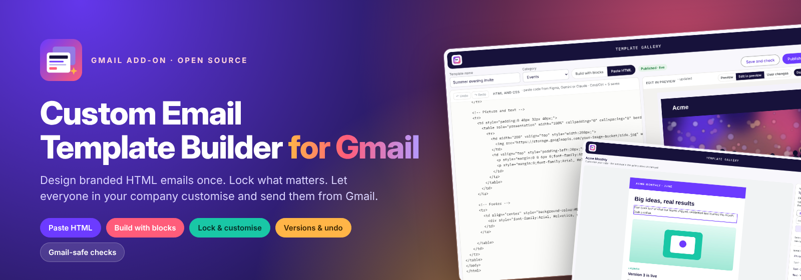
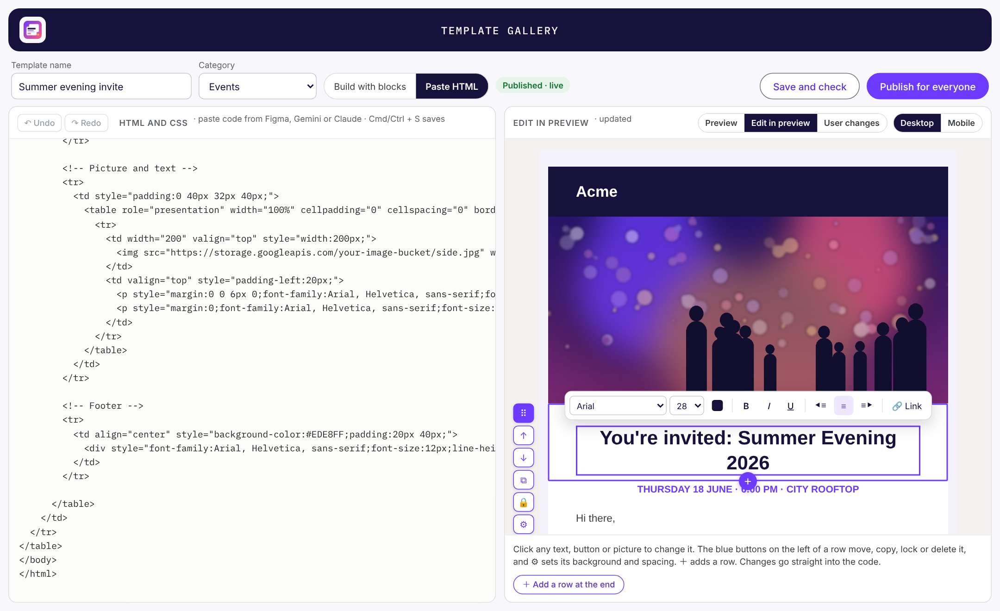
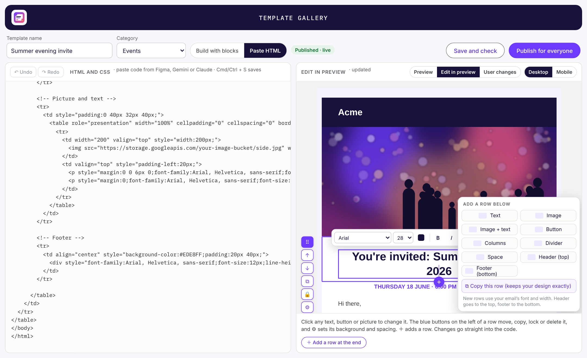
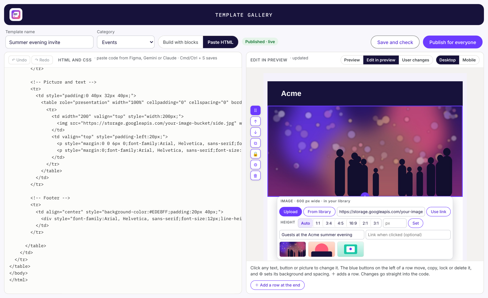
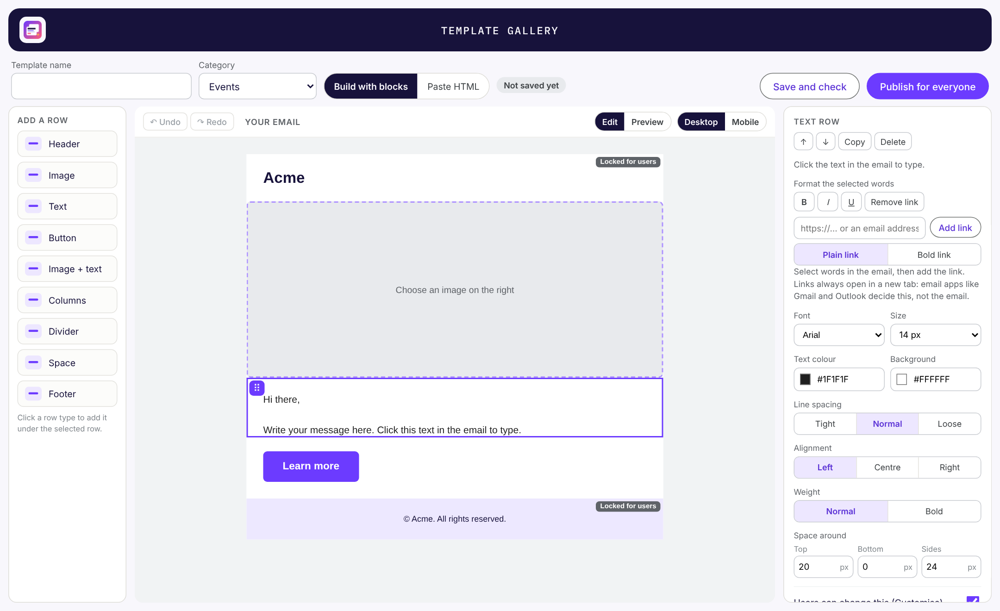
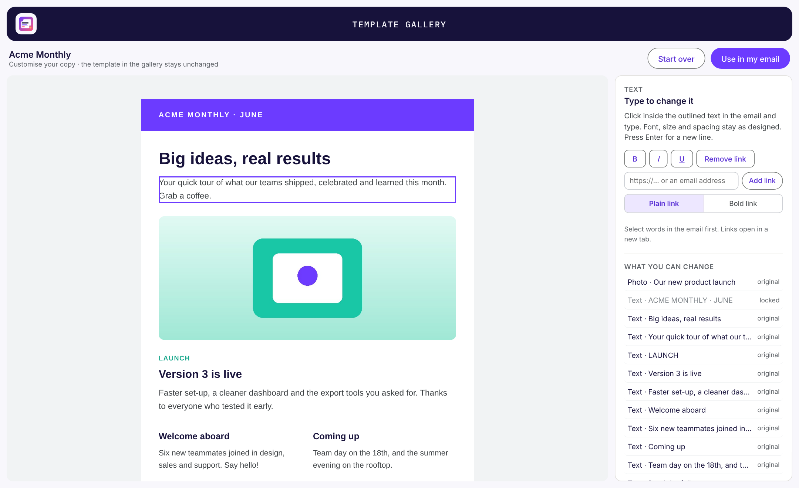
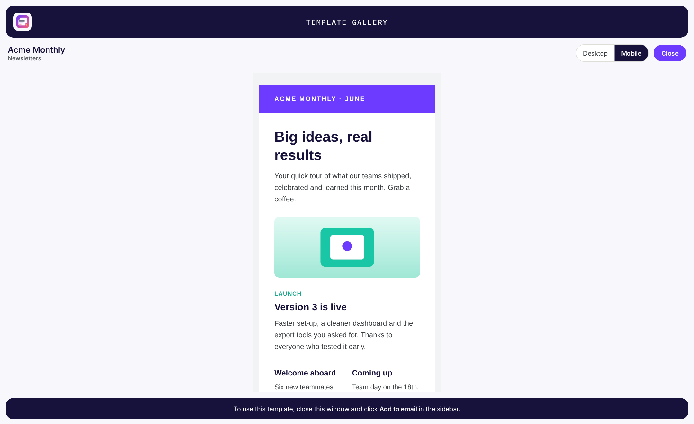
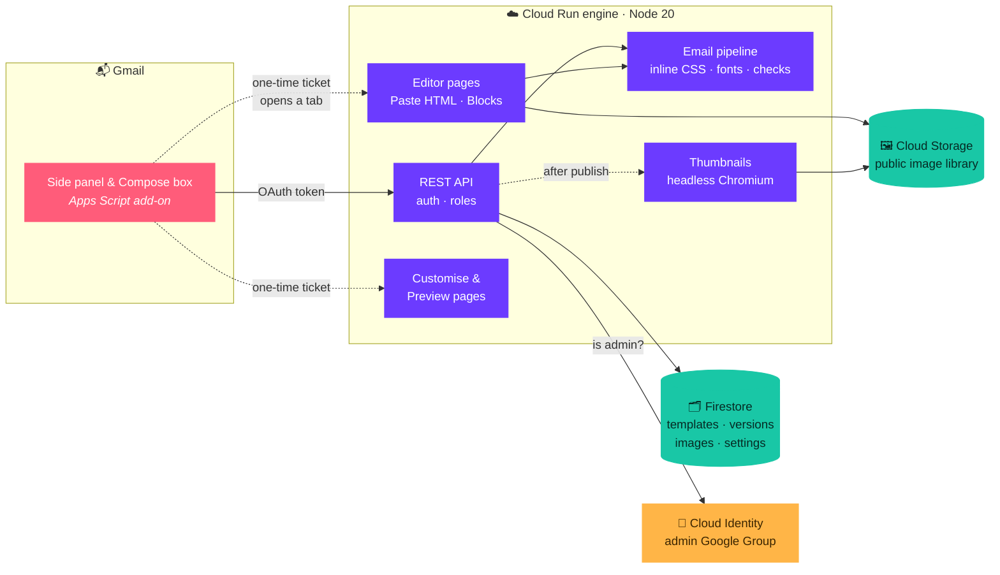

<p align="center">
  
</p>

<h1 align="center">Custom Email Template Builder – Gmail</h1>

<p align="center">
  <b>Branded HTML email templates for your whole company, right inside Gmail.</b><br>
  Admins design and lock. Everyone else customises and sends.
</p>

<p align="center">
  
  
  
  
  
</p>

<p align="center">
  <a href="#-what-it-does">What it does</a> ·
  <a href="#-see-it">See it</a> ·
  <a href="#-how-it-works">How it works</a> ·
  <a href="#-quick-start">Quick start</a> ·
  <a href="#-make-it-yours">Make it yours</a> ·
  <a href="#-credits">Credits</a>
</p>

---

## ✨ What it does

Marketing teams design beautiful emails in Figma, Canva or with AI, but getting them into everyone's Gmail usually means a paid marketing tool or copy-paste that breaks the layout. This project is a **Gmail add-on with a small Google Cloud engine** that fixes that:

- 🎨 **Admins build templates** by pasting HTML (from Figma plugins, ChatGPT, Gemini or Claude) or by **building with blocks**, then **lock** the parts that must never change and **publish** to everyone.
- ✍️ **Everyone else** opens the side panel in Gmail, picks a template, **changes only what's allowed** (photos, text) and clicks **Add to email**.
- ✅ **Every template is made Gmail-safe automatically:** CSS is inlined, fonts get safe backups, widths become fluid, and a checklist warns about anything Gmail would break.

### For admins

| | |
|---|---|
| 🧩 **Two ways to build** | **Paste HTML** with *Edit in preview*, or **Build with blocks** (header, image, text, button, image + text, columns, divider, space, footer) |
| 🖱️ **Edit in preview** | Click any text, button, picture or row: fonts (39), sizes 10–72, colours, alignment, links, button styles |
| 🧱 **Rows** | Add, drag, move, copy, delete, set background and spacing; add a **header** or **footer** row in one click |
| 🔒 **Locks** | Lock any part or a whole row; users can't change it when customising |
| 🖼️ **Image library** | Upload, pick, **copy into library** from other sites, cut to shapes (1:1, 4:5, 16:9…), safe remove |
| ↩️ **Undo, redo & versions** | Last 50 changes, `Cmd + Z`; every publish is kept and can be **restored** |
| 👥 **Teamwork** | Make a copy, categories (show/hide, rename, delete), a warning when two admins save the same template |
| ⚡ **Fast publish** | Live in a few seconds; the gallery thumbnail is made in the background |

### For everyone

| | |
|---|---|
| 📚 **Gallery** | Categories and thumbnails in Gmail's side panel and Compose box |
| 👀 **Preview** | Desktop and mobile |
| ✏️ **Customise** | Retype text, swap photos (always fitted to the frame), bold / italic / links, with locked parts protected |
| 📨 **Add to email** | Opens a new email, or fills the one you're writing |

---

## 👀 See it

<table>
  <tr>
    <td width="50%"><br><sub><b>Edit in preview:</b> click text for font, size, colour, alignment and links. Row tools sit on the left.</sub></td>
    <td width="50%"><br><sub><b>Add a row:</b> text, image, button, columns, header, footer, or copy a row to keep your exact design.</sub></td>
  </tr>
  <tr>
    <td><br><sub><b>Image tools:</b> upload, library, copy into library, heights and alt text.</sub></td>
    <td><br><sub><b>Build with blocks:</b> rows, fonts, sizes, colours, spacing and locks, with no code.</sub></td>
  </tr>
  <tr>
    <td><br><sub><b>Customise:</b> users change only what the admin allowed.</sub></td>
    <td><br><sub><b>Preview:</b> check desktop and mobile before sending.</sub></td>
  </tr>
</table>

---

## 🧠 How it works



- The **add-on** (Apps Script, CardService) is the Gmail side panel. It calls the engine with the user's Google sign-in token.
- The **engine** (Node 20 on Cloud Run) checks the token, your domain and admin group, stores everything in **Firestore**, keeps pictures in a public **Cloud Storage** bucket, and serves the editor, customise and preview pages through **one-time tickets**.
- The **pipeline** turns any pasted or built email into Gmail-safe HTML and explains every change it made.

Read more in **[docs/architecture.md](docs/architecture.md)**.

---

## 🚀 Quick start

You need a Google Workspace domain and a Google Cloud project with billing.

```bash
git clone https://github.com/nexoradev-stack/Custom-Email-Template-Builder-Gmail.git
cd Custom-Email-Template-Builder-Gmail/engine
cp env.example.yaml env.yaml        # fill in your project, bucket, domain and admin group
npm ci && npm test                  # optional: run the tests locally

gcloud run deploy template-engine --source . --region us-central1 \
  --service-account template-engine@YOUR_PROJECT.iam.gserviceaccount.com \
  --allow-unauthenticated --env-vars-file env.yaml \
  --memory 2Gi --cpu 1 --max-instances 3 --timeout 60 --cpu-boost
```

Then paste `addon/Code.gs` and `addon/appsscript.json` into an Apps Script project, put your engine's URL in both, and install it as a test deployment.

📘 **Full step-by-step guide:** [docs/setup.md](docs/setup.md)

---

## 🎨 Make it yours

Your brand lives in settings, not in the code. Set these in `engine/env.yaml`:

| Setting | What it changes | Default |
|---|---|---|
| `APP_NAME` | Name on every page | `Template Gallery` |
| `BRAND_NAME` | Text in new header and footer rows | `Acme` |
| `BRAND_WEBSITE` | Default link for new buttons | `https://www.example.com` |
| `BRAND_LOGO_URL` | Small logo in the top band | `/assets/logo-mark.png` |
| `BRAND_INK` | Dark colour: top band, text, header rows |  |
| `BRAND_ACCENT` | Buttons, links, selection |  |
| `BRAND_SOFT` | Footer rows |  |
| `BRAND_PAGE` | Page background |  |

In the add-on, change `APP_NAME`, `BLUE` and `BLUE_DARK` at the top of `Code.gs`, and the name, colours and icon in `appsscript.json`. Details in [docs/setup.md](docs/setup.md#7-make-it-yours).

---

## 🗂️ Project structure

```
.
├── addon/                  Gmail add-on (Google Apps Script)
│   ├── Code.gs             side panel, compose box, admin cards
│   └── appsscript.json     add-on manifest
├── engine/                 Cloud Run engine (Node 20, Express)
│   ├── src/
│   │   ├── server.js       routes, Firestore, Cloud Storage, versions, tickets
│   │   ├── auth.js         token check, domain, admin group
│   │   ├── pipeline.js     Gmail-safe HTML: inline CSS, fonts, widths, checks
│   │   ├── blocks.js       finds the editable parts; locks
│   │   ├── theme.js        your brand settings
│   │   ├── editorPage.js   the editor tab
│   │   ├── builder.client.js   Build with blocks
│   │   ├── htmledit.client.js  Paste HTML: edit in preview, rows, undo
│   │   ├── customisePage.js    what users see when customising
│   │   └── …
│   ├── assets/             icon, logo and placeholders
│   ├── test/               node:test unit tests
│   ├── Dockerfile
│   └── env.example.yaml
├── examples/templates/     two ready-to-paste templates
└── docs/                   setup, architecture, guides, images
```

---

## 📏 Good to know

Gmail decides a lot about how emails look. The engine tells you when something will change instead of letting it break silently.

- **Web fonts don't load in Gmail.** Every font has a backup (usually Arial), and the check says which one people will see.
- **Mobile `@media` rules are removed by Gmail.** Widths are made fluid instead, so emails still fit phones.
- **Text inside pictures can't be edited.** Use real text for titles you want people to change.
- **Merge tags** like `{{FirstName}}` aren't filled in by Gmail. The check warns you about them.
- **Over 102 KB, Gmail cuts the email.** The check shows the size and stops you at the limit.
- The add-on runs in **Gmail on the web**. Gmail's phone apps don't show add-on side panels, but emails sent with it look right everywhere.

---

## 🤝 Contributing

Ideas, bug reports and pull requests are welcome. Start with **[CONTRIBUTING.md](CONTRIBUTING.md)**, and please report security problems privately as described in **[SECURITY.md](SECURITY.md)**.

---

## 💜 Credits

| | Who | Role |
|---|---|---|
| 🎨 | **Legends** ([@nexoradev-stack](https://github.com/nexoradev-stack)) | Product, design, testing and direction |
| 🤖 | **Claude** (Anthropic) | Code, architecture and docs, pair-built with Legends |
| ⌨️ | **Cursor** | AI code editor used in the build |

---

## 📄 Licence

[MIT](LICENSE). Use it, change it, and make it yours.
