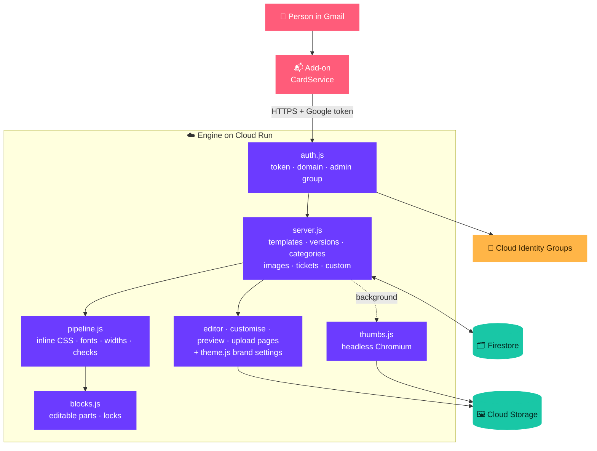

# 🧠 Architecture

The project has two parts that talk over HTTPS:

| Part | Runs on | Job |
|---|---|---|
| **Add-on** (`addon/`) | Google Apps Script, inside Gmail | The side panel and Compose box: gallery, admin cards, Add to email |
| **Engine** (`engine/`) | Cloud Run (Node 20, Express) | Storage, roles, the Gmail-safe pipeline, editor / customise / preview pages, thumbnails |

---

## Who can do what

1. Every API call from the add-on carries the person's **Google OAuth access token**.
2. `auth.js` checks it with Google: the email is verified, ends with `@ALLOWED_DOMAIN`, and the token was issued to **this add-on's** OAuth client (by `OAUTH_CLIENT_ID`, or the `PROJECT_NUMBER` prefix). Results are cached for 5 minutes.
3. **Admins** are members of `ADMIN_GROUP`, looked up in Cloud Identity with the person's own token. `ADMIN_EMAILS` is an optional safety net.
   **Users** see only the categories given to them (everyone, one of their teams, or their email) and never see hidden templates. The engine checks this on the gallery, search, preview, customise and direct template links.
4. The editor, customise, preview and upload pages open in a **browser tab**. The add-on first asks the engine for a **one-time ticket** (valid 10 minutes, tied to the person and the template) and opens `…/editor?ticket=…`. The page uses the ticket for its calls, so no Google token ever sits in a URL.
5. Pages are sent with a strict **Content-Security-Policy**. Email previews render in **sandboxed iframes**, so code in a pasted template can never run.

## The pipeline: from any HTML to Gmail-safe HTML

`pipeline.js` runs on every check, save and publish:

```mermaid
flowchart LR
  IN["Pasted or built HTML"] --> P1["Reject plain text<br/>and oversize input"]
  P1 --> P2["Inline all CSS<br/>(juice)"]
  P2 --> P3["Drop scripts, forms,<br/>external CSS, @media"]
  P3 --> P4["Fonts → list of 39<br/>+ safe backups"]
  P4 --> P5["Fixed widths → fluid"]
  P5 --> P6["Image checks<br/>library · outside · blocked"]
  P6 --> P7["Size vs Gmail's 102 KB"]
  P7 --> OUT["Gmail-ready HTML<br/>+ checklist"]
  classDef s fill:#EDE8FF,stroke:#6C3BFF,color:#17123B
  class P1,P2,P3,P4,P5,P6,P7 s
```

Each step adds a line to the checklist (**ok**, **check** or **error**), so admins always see what changed and why. Errors block publishing.

## Parts and locks

`blocks.js` gives every **image** (`i0, i1…`) and every **piece of text** (`t0, t1…`) a stable id, in reading order. The ids are attributes in the preview only; `cleanForEmail` removes them before anything is sent.

- Admins lock ids from **User changes**, a row's 🔒, or a block's *Let users change this* switch.
- `data-lock` in the code locks a part permanently.
- On **Customise**, locked parts can't be selected or edited. *(Planned: the engine will also compare the saved copy with the template, so a tampered page can't change a locked part. See the issues.)*
- When rows are added, moved or deleted in *Edit in preview*, the browser gives the ids again the same way the server does, and moves each lock with its part.

## The two editors

| | Paste HTML (`htmledit.client.js`) | Build with blocks (`builder.client.js`) |
|---|---|---|
| Source of truth | The code box | A JSON model `{ width, page, bg, rows[] }` |
| Editing | *Edit in preview*: floating tools over the preview; every change is written back into the code | Rows with settings panels; HTML is generated from the model |
| Rows | The rows of the email's main table (found automatically) | The model's rows |
| Undo | Snapshots of code and locks | Snapshots of the model |

Switching from Paste HTML to blocks keeps the pasted code safe until the admin chooses which version to keep.

## Data

| Firestore collection | Holds |
|---|---|
| `templates` | name, category, mode, source HTML / block model, locks, status, published HTML, version, thumbnail, who changed it and when |
| `templates/{id}/versions` | every published version, for **Restore** |
| `images` | the image library: name, public URL, size, who uploaded it; `sourceUrl` for copies of outside pictures |
| `settings` | categories (order, names, who can see each: everyone, or team ids and email addresses) and teams (name and members) |
| `tickets` | one-time tickets for the browser pages (short-lived) |
| `custom` | each person's customised copy (one at a time, 24 hours) |

Cloud Storage holds library pictures, cut copies in `cut/`, and thumbnails. **Removing** a picture from the library only removes the list entry. The file stays, so emails already sent never lose their pictures, and removing is refused while a template still uses it.

## Publishing

1. The engine runs the pipeline and refuses on errors.
2. It saves the published HTML, adds a version, and answers within a few seconds.
3. A background job renders a thumbnail with headless Chromium and stores it. The gallery picks it up on the next refresh.

Two admins editing at once: every save sends the time the admin's copy was loaded. If someone else saved since, the engine answers `409` with their name, and the admin can reload or save anyway.

## Main API routes

| Route | Who | Purpose |
|---|---|---|
| `GET /api/templates` · `GET /api/templates/:id` | everyone | Gallery and template details |
| `POST /api/templates` · `/publish` · `/unpublish` · `/delete` · `/copy` | admins | Manage templates |
| `GET /api/templates/:id/versions` · `POST /restore` | admins | Versions |
| `GET/POST /api/categories` | admins | Categories: who can see each, add, rename, delete |
| `GET/POST /api/teams` | admins | Teams: create, rename, delete, add and remove people |
| `POST /api/templates/:id/hidden` | admins | Hide a template from users, or show it again |
| `GET /api/images` · `POST /api/images/remove` | admins | Image library |
| `POST /api/editor-ticket` → `GET /editor` | admins | Editor tab |
| `/editor/check` · `/save` · `/publish` · `/upload` · `/crop` · `/import` · `/images` | editor tab | Editor actions |
| `POST /api/customise-ticket` → `GET /customise` | everyone | Customise tab |
| `GET /api/custom` · `POST /api/custom/discard` | everyone | The person's customised copy |
| `POST /api/preview-ticket` → `GET /preview` | everyone | Preview tab |
| `GET /health` | anyone | Health check |
